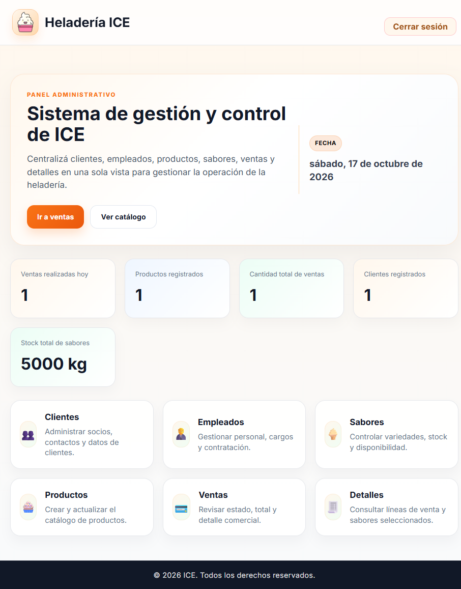
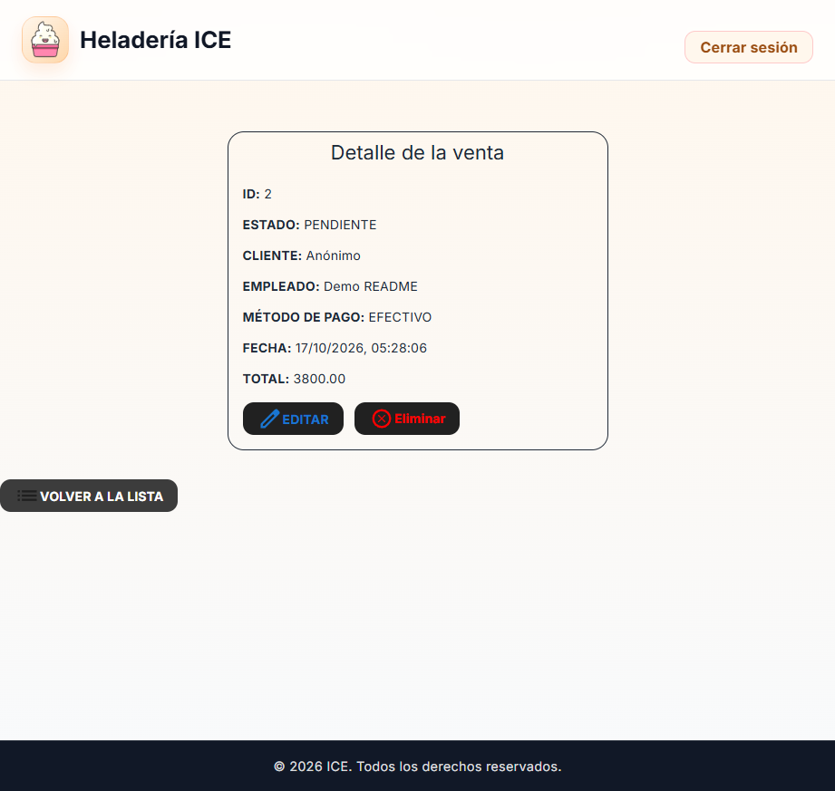

# Sistema de gestión de heladería ICE

Aplicación web para administrar clientes, empleados, productos, sabores y ventas de una heladería. Incluye una API REST en Django, una interfaz en Vue y PostgreSQL como base de datos para el entorno Docker.

ICE centraliza la operación diaria del local: mantiene el catálogo y los clientes, y permite registrar ventas con su empleado, método de pago y productos. El flujo habitual es iniciar sesión, revisar o actualizar el catálogo, crear una venta pendiente, agregar sus detalles y completarla para que se actualice el stock de sabores.

## Capturas





La ficha de venta es ilustrativa y se generó con datos de prueba; esos registros temporales no forman parte de la base del proyecto.

## Funcionalidades actuales

- Gestión de clientes, con indicador de socio.
- Gestión de empleados y puesto: gerente, cajero o limpieza.
- Gestión de sabores, disponibilidad y stock en kilogramos.
- Gestión de productos, precio, tamaño y sabores permitidos.
- Registro de ventas, sus detalles, empleado, cliente y método de pago.
- Validación del flujo de venta y descuento/devolución del stock de sabores al completar/cancelar una venta.
- Panel con contadores básicos de ventas del día, productos, clientes y stock de sabores.
- API protegida con JWT y acceso de escritura limitado a usuarios autenticados con permiso de staff.

## Tecnologías y estructura

- Backend: Python, Django 4.2, Django REST Framework y Simple JWT.
- Frontend: Vue 3, TypeScript, Vite, Pinia, Vue Router y Vuetify.
- Base de datos: PostgreSQL 15.
- Entorno: Docker Compose.

```text
backend/config/django-image/   Imagen y arranque de Django
backend/src/django/app/        Configuración del proyecto Django
backend/src/django/heladeria/  Modelos, API y pruebas del negocio
backend/src/django/auth_app/   Endpoints JWT
frontend/                      Aplicación Vue
bin/                           Scripts de ayuda para backend
```

## Requisitos

- Docker Desktop con Docker Compose.
- Node.js y npm para ejecutar el frontend fuera de Docker.
- Python 3 y pip, únicamente si vas a instalar HTTPie para probar la API.

HTTPie es opcional para ejecutar la aplicación. Para instalarlo desde PowerShell:

```powershell
python -m pip install httpie
http --version
```

## Configuración y puesta en marcha

1. Crear `.env` a partir de `.env-dist` y revisar sus valores. El archivo contiene valores de desarrollo; reemplazá especialmente las contraseñas y `DJANGO_SECRET_KEY` antes de cualquier despliegue.

   ```powershell
   Copy-Item .env-dist .env
   ```

2. Iniciar PostgreSQL y la API:

   ```powershell
   docker compose up --build -d
   ```

   El contenedor espera a que PostgreSQL esté disponible, aplica migraciones y crea o actualiza el superusuario con `DJANGO_SU_NAME`, `DJANGO_SU_EMAIL` y `DJANGO_SU_PASSWORD`.

3. Iniciar el frontend en otra terminal:

   ```powershell
   Set-Location frontend
   npm install
   npm run dev
   ```

4. Abrir la dirección que informa Vite (configurada en este proyecto como `http://localhost:4174`). La API queda disponible en `http://localhost:8000` y el admin de Django en `http://localhost:8000/admin/`.

Comandos útiles:

```powershell
docker compose logs -f heladeria_api
docker compose exec heladeria_api python manage.py test
docker compose down
```

Para abrir una consola Django:

```powershell
docker compose exec heladeria_api python manage.py shell
```

## API y autenticación

Base de la API: `http://localhost:8000/heladerias/`

| Recurso | Colección | Elemento |
| --- | --- | --- |
| Clientes | `clientes/` | `clientes/<id>/` |
| Empleados | `empleados/` | `empleados/<id>/` |
| Sabores | `sabores/` | `sabores/<id>/` |
| Productos | `productos/` | `productos/<id>/` |
| Ventas | `ventas/` | `ventas/<id>/` |
| Detalles de venta | `detalle-ventas/` | `detalle-ventas/<id>/` |

Autenticación JWT, bajo `http://localhost:8000/heladerias/auth/`:

- `token/`: obtiene tokens de acceso y renovación.
- `token/refresh/`: renueva el token de acceso.
- `token/verify/`: verifica un token.

Las lecturas requieren un usuario autenticado. Las operaciones de creación, edición y eliminación requieren además `is_staff`. El superusuario configurado al iniciar Docker cumple ambos requisitos. Los puestos registrados en `Empleado` son datos del negocio; no se traducen automáticamente en cuentas de usuario ni permisos separados.

Ejemplo desde PowerShell. Reemplazá el usuario y la contraseña por los valores configurados en `.env`:

```powershell
http POST http://localhost:8000/heladerias/auth/token/ username=admin password=tu_clave_configurada
```

Copiá el valor de `access` de la respuesta y usalo para consultar un endpoint protegido:

```powershell
$accessToken = "PEGAR_ACCESS_AQUI"
http GET http://localhost:8000/heladerias/productos/ "Authorization:Bearer $accessToken"
```

Para crear una venta, el usuario autenticado también debe tener permiso de staff:

```powershell
http POST http://localhost:8000/heladerias/ventas/ "Authorization:Bearer $accessToken" cliente:=1 empleado:=1 metodo_pago=EFECTIVO estado=PENDIENTE
```

## Reglas principales de ventas

- Una venta nueva comienza como `PENDIENTE`.
- Una venta pendiente puede completarse o cancelarse.
- Una venta completada puede cancelarse; una cancelada no puede reabrirse.
- No se puede completar una venta sin detalles.
- Los detalles solo se modifican mientras la venta está pendiente.
- Al completar, se descuenta del stock la cantidad de sabores calculada según los gramos del producto; al cancelar una venta completada, se devuelve.
- El precio del detalle queda registrado en la venta; el total se calcula a partir de sus subtotales.

La cancelación devuelve stock, pero no registra por sí sola un reembolso ni un movimiento de caja.

## Pruebas y compilación

Pruebas del backend:

```powershell
docker compose exec heladeria_api python manage.py test
```

Pruebas y build del frontend:

```powershell
Set-Location frontend
npm test
npm run build
```
